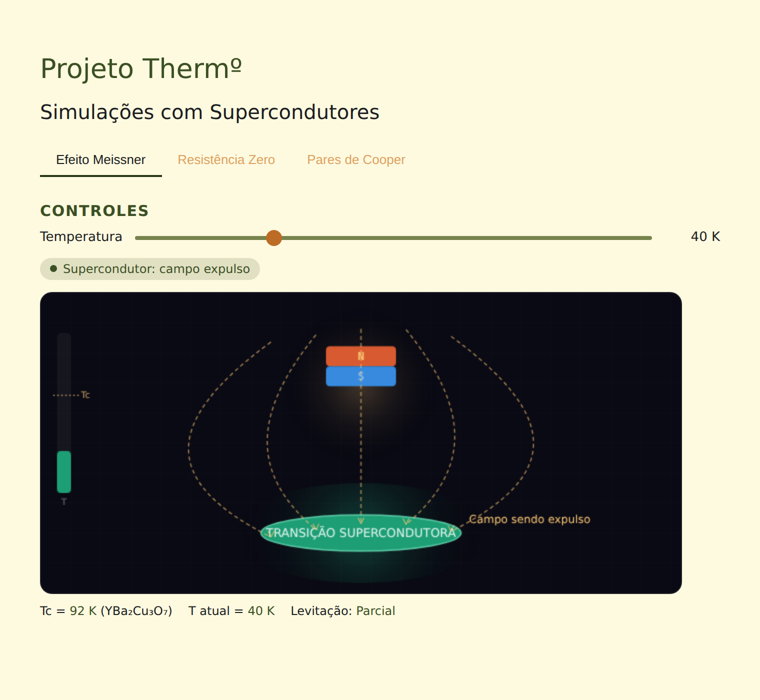

# Projeto Therm° — Simulações com Supercondutores

Página web interativa que faz parte do Projeto Therm°, um estudo sobre o uso de aprendizado de máquina para encontrar materiais supercondutores sem depender de terras raras. Esta página reúne três simulações visuais que explicam, de forma intuitiva, os fenômenos físicos por trás da supercondutividade: o Efeito Meissner, a Resistência Zero e os Pares de Cooper.

Em cada simulação, o visitante ajusta a temperatura do material (e, numa delas, também a corrente elétrica) e observa em tempo real o que acontece quando o material cruza a temperatura crítica (Tc) e se torna supercondutor.

## Demonstração

A simulação do Efeito Meissner com a temperatura abaixo da Tc (40 K, material supercondutor): o ímã levita e as linhas de campo magnético são expulsas do material.



## Requisitos

- Qualquer navegador moderno (Chrome, Firefox, Edge, Safari).

Não há dependências externas, bibliotecas ou instalação de pacotes: a página usa apenas HTML, CSS e JavaScript puro, sem nenhuma chamada à internet.

## Instalação

1. Baixe ou clone este repositório.
2. Entre na pasta do projeto. Não há nenhum outro passo de instalação.

## Uso

Dê duplo clique em `index.html` (ou abra-o pelo navegador com **Arquivo → Abrir**) para carregar a página localmente.

Opcionalmente, você pode servir a pasta com um servidor estático, o que é equivalente:

```bash
python3 -m http.server 8000
```

E então acessar `http://localhost:8000` no navegador.

### Exemplo

Na aba **Efeito Meissner** (aberta por padrão):

1. Mova o controle deslizante de **Temperatura** para baixo de 92 K (a Tc do material, YBa₂Cu₃O₇).
2. O indicador de status muda de "Estado normal" para "Supercondutor: campo expulso".
3. O ímã, que antes repousava sobre o material, sobe gradualmente (levita), e as linhas de campo magnético passam a contornar o material em vez de atravessá-lo.
4. Mova o controle de volta para acima de 92 K para ver o material retornar ao estado normal.

As outras duas abas seguem a mesma lógica com outras variáveis:

- **Resistência Zero**: ajuste a temperatura e a corrente para comparar a corrente de entrada e saída num fio. Acima da Tc, parte da corrente se perde (resistência); abaixo da Tc, a saída é idêntica à entrada.
- **Pares de Cooper**: ajuste a temperatura para ver os elétrons passarem de um movimento aleatório e desordenado (estado normal) para um movimento em pares alinhados (estado supercondutor).

## Estrutura do projeto

```
projeto-thermo/
├── README.md       # Este documento
├── LICENSE         # Texto da licença MIT
├── index.html      # Estrutura da página e lógica das três simulações
├── style.css       # Estilo visual da página (cores, layout, tabs)
└── assets/
    └── demo.png    # Captura de tela usada na seção Demonstração
```

`index.html` contém a lógica das simulações (desenho nos `<canvas>`, controles e animações) em um bloco `<script>` interno. O repositório também inclui `script.js`, com uma versão anterior dessa mesma lógica; atualmente `index.html` não o carrega, então ele não é necessário para a página funcionar — está aqui apenas como parte do histórico de desenvolvimento do projeto.

## Licença

Este projeto está distribuído sob a licença MIT. Consulte o arquivo [GUILHERME MESQUITA](GUILHERME MESQUITA) para o texto completo.
